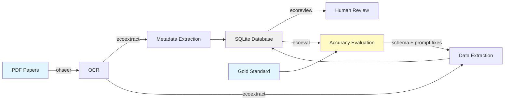

# ecoeval

Measure how accurately an AI extraction pipeline performed against a
human-curated gold standard.

## Pipeline



| Package | Purpose | Links |
| ------- | ------- | ----- |
| [ohseer](https://github.com/n8layman/ohseer) | OCR processing (Mistral, Tensorlake, Claude) | [GitHub](https://github.com/n8layman/ohseer) |
| [ecoextract](https://github.com/n8layman/ecoextract) | AI-powered extraction pipeline | [Docs](https://n8layman.github.io/ecoextract/) \| [GitHub](https://github.com/n8layman/ecoextract) |
| [ecoreview](https://github.com/n8layman/ecoreview) | Interactive Shiny review app | [Docs](https://n8layman.github.io/ecoreview/) \| [GitHub](https://github.com/n8layman/ecoreview) |
| [ecoeval](https://github.com/n8layman/ecoeval) | Accuracy evaluation against a gold standard | [Docs](https://n8layman.github.io/ecoeval/) \| [GitHub](https://github.com/n8layman/ecoeval) |

## The problem it solves

You have two sets of results from the same papers: one the AI produced, one a
person produced by hand. You want to know how well the AI did.

You can't just lay the two tables side by side. People — and AI — often describe
the same thing in different ways: a different spelling, a name written out in
full on one side and shortened on the other, or a sentence worded differently
with the same meaning. So the rows don't line up on their own.

So ecoeval works in two steps. First it **pairs up the rows**, matching each AI
row to the human row describing the same thing. It uses probabilistic record
linkage, fuzzy matching for near-identical text, and an AI reviewer where the
wording differs but the meaning may not. Then it **scores the result**:
precision, recall, and field-level accuracy across the whole set.

You don't have to check every row. Press **Resolve all differences** and read
the numbers. Go through the papers one at a time when you want to see why the
extraction gets things wrong.

## Installation

```r
# renv (recommended for renv-managed projects)
renv::install("n8layman/ecoeval")

# pak
pak::pak("n8layman/ecoeval")

# remotes
remotes::install_github("n8layman/ecoeval")
```

## Usage

```r
library(ecoeval)

# Launch and pick inputs in the app
run_eval_app()

# Or supply them up front
run_eval_app(
  ai     = "ecoextract_records.db",
  gold   = "gold_standard.csv",
  schema = "ecoextract/schema.json"
)
```

## Status

Working. The evaluation runs end to end: load, align papers, align records,
score, read the numbers, export the bundle. The AI steps (normalising names and
the AI reviewer) need an API key. Without one, the plain comparisons still run,
and cells they can't settle are marked as waiting for the AI reviewer and
counted as differences.

See [`DESIGN.md`](DESIGN.md) for the full design, including a **Deliberately
out of scope** section listing what was considered and left out, and why.

### Scripting it

Everything the app computes is also available as plain functions over data
frames, so you can run an evaluation from a script:

```r
run <- ecoeval::evaluate_extraction(
  ai     = "ecoextract_records.db",
  gold   = "gold_standard.csv",
  schema = "ecoextract/schema.json"
)

ecoeval::aggregate_metrics(run$cells)
ecoeval::field_metrics(run$cells)   # sorted worst first
run$findings                        # grouped schema / model / gold
```

To see it work with no data of your own, press **Use the bundled example** on
the load screen, or point the arguments at the synthetic fixtures in
`inst/extdata/`.

## Requirements

- R >= 4.0
- [ecoextract](https://github.com/n8layman/ecoextract) output, or any record
  table plus the `schema.json` it was extracted against
- An API key for the AI reviewer (copy `.env.example` to `.env`)

## License

Copyright (C) 2026 Nathan Layman

ecoeval is free software: you can redistribute it and/or modify it under the
terms of the GNU General Public License as published by the Free Software
Foundation, either version 3 of the License, or (at your option) any later
version.

This program is distributed in the hope that it will be useful, but WITHOUT
ANY WARRANTY; without even the implied warranty of MERCHANTABILITY or FITNESS
FOR A PARTICULAR PURPOSE. See the GNU General Public License for more details.

The full license text is in [LICENSE](LICENSE).
